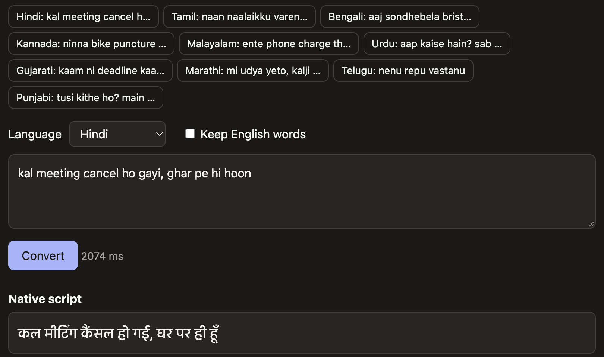
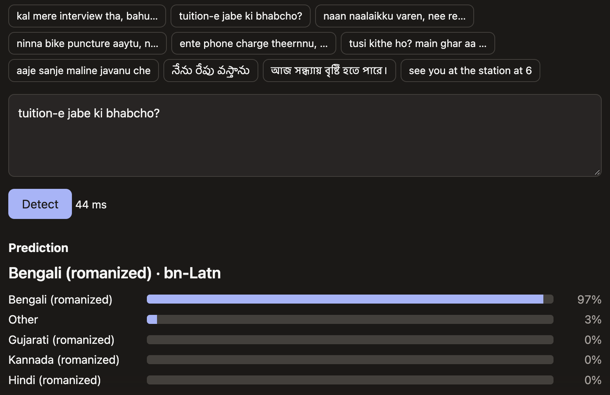

<p align="center"></p>

<p align="center">
  <a href="LICENSE"></a>
  <a href="https://huggingface.co/collections/altslate/indic-chat-toolkit-6b00d1ccbffba7be2baa5fdd"></a>
  
  
  
</p>

# Indic chat toolkit: training and evaluation code

Code behind five small models for Indian-language text: message-level and word-level language ID and transliteration for romanized and native-script chat in 12 South Asian languages (Hindi, Bengali, Tamil, Telugu, Marathi, Gujarati, Kannada, Malayalam, Punjabi, Urdu, Sindhi, Sinhala), and text normalization for speech in 10 of them, both directions (TTS input and ASR output).

| Model | What it does | Size | Hub | Demo |
|---|---|---|---|---|
| [**indic-chat-lid-small**](https://huggingface.co/altslate/indic-chat-lid-small) | Language ID, native script **and** romanized (26 labels) | 140M | [](https://huggingface.co/altslate/indic-chat-lid-small) | [](https://huggingface.co/spaces/altslate/indic-chat-lid) |
| [**indic-chat-wordlid-small**](https://huggingface.co/altslate/indic-chat-wordlid-small) | Word-level language ID for code-mixed chat (12 languages + English, incl. two Indian languages in one message) | 140M | [](https://huggingface.co/altslate/indic-chat-wordlid-small) | [](https://huggingface.co/spaces/altslate/indic-chat-lid) |
| [**indic-chat-xlit-small**](https://huggingface.co/altslate/indic-chat-xlit-small) | Romanized chat → native script, whole sentences | 300M | [](https://huggingface.co/altslate/indic-chat-xlit-small) | [](https://huggingface.co/spaces/altslate/indic-chat-xlit) |
| [**indic-tts-normalizer-small**](https://huggingface.co/altslate/indic-tts-normalizer-small) | Written → spoken form for TTS (₹ amounts, times, dates, phone numbers, units, cricket scores…), 10 languages | 300M | [](https://huggingface.co/altslate/indic-tts-normalizer-small) | [](https://huggingface.co/spaces/altslate/indic-tts-normalizer) |
| [**indic-itn-small**](https://huggingface.co/altslate/indic-itn-small) | Spoken → written for ASR output (numbers, ₹, times, dates → digits), 10 languages | 300M | [](https://huggingface.co/altslate/indic-itn-small) | [](https://huggingface.co/spaces/altslate/indic-tts-normalizer) |

Results, data provenance and limitations are on the model cards. This repository is the code **as it was run** to build and test them: research scripts, not a library. It is published so the numbers on the cards can be checked and reproduced.

## Demos

All three demos run the int8 ONNX models in your browser with [transformers.js](https://github.com/huggingface/transformers.js); your text never leaves your device.

<table>
<tr>
<td width="50%"><a href="https://huggingface.co/spaces/altslate/indic-chat-xlit"></a><br><sub><b>Transliteration</b>: romanized Hindi to Devanagari, about 2 s in the browser.</sub></td>
<td width="50%"><a href="https://huggingface.co/spaces/altslate/indic-chat-lid"></a><br><sub><b>Language ID</b>: "tuition-e jabe ki bhabcho?" → romanized Bengali, 97%.</sub></td>
</tr>
</table>

## Layout

```
src/wordlid/ word-level language ID: labelled mixed-message synthesis, COMI-LINGUA test, English-word convention, training, ONNX checks
src/lid/     language ID: data synthesis, training (mmBERT-small), test sets, comparisons with GlotLID and IndicLID, ONNX export
src/xlit/    transliteration: data building, training (ByT5-small), prediction, CER metric, IndicXlit / UnimeType baselines, ONNX checks
src/tn/      TTS normalization: carrier sentences, slot filling with exact spoken forms, number-word fixes, tests, LLM judge, baselines
src/itn/     inverse text normalization: the TN data reversed with canonical written forms, real-sentence tests, digit-match scorer, baselines
jobs/<id>/   the shell script for each GPU job, in the order they were run (see below)
spaces/      the three browser demos (static HTML + transformers.js; the models run in the browser)
```

### Which jobs produced the released models

**indic-chat-lid-small (released version = `lid-v4`)**

1. `lid-gap`: Dakshina test-split test set (test A) and the first GlotLID comparison.
2. `lid-testb`: chat test set (test B), written by a separate "test teacher" model (Qwen3.8-27B) that wrote no training text.
3. `lid-chat`, `lid-chat4`: romanized chat training pairs written by the training teacher (Ornith-1.5-35B-A3B), including out-of-scope Indic languages as `other`.
4. `lid-indiclid`: the IndicLID baseline (FTN/FTR + BERT stage).
5. `lid-v4`: training data synthesis (`src/lid/synth_lid.py`), training (`src/lid/train_lid.py`) and the comparison tables.
6. `onnx-lid`: ONNX export and int8 quantization.

**indic-chat-wordlid-small (released version = `wordlid-v3`)**

1. `wordlid-gap` (no script): COMI-LINGUA LID test (`src/wordlid/comi_test.py`, gold = majority of 3 annotators) and the PhysicsWallahAI/muril-hinglish-lid baseline (`baseline_muril.py`).
2. `wordlid-v1`: synthetic labelled messages (`synth_wordlid.py`) and the test-mix set from Dakshina's test split; `wordlid-v2`: + COMI-LINGUA train split, English Wikipedia; `wordlid-v3`: + English-word convention (`envocab.py`, applied to the test too via `relabel_test.py`) and real romanized chat segments.
3. `onnx-wordlid`: fp32 + per-channel int8 export (`src/export_onnx.py`, `src/requant_onnx.py`) and word accuracy through onnxruntime (`onnx_check.py`).

**indic-chat-xlit-small (v0 → v1 → v2; the Hub has tags `v0`, `v1`; `main` is v2)**

1. `xlit-gap`: test A (Dakshina test split) and test B (chat), plus copy baselines.
2. `xlit-indicxlit`: the AI4Bharat IndicXlit baseline (runs in a python:3.10 container with fairseq 0.12.2).
3. `xlit-v0`, `xlit-v1`, `xlit-v2`: data (`src/xlit/build_data*.py`), training (`src/xlit/train_xlit.py`) and evaluation; each version is warm-started from the previous one.
4. `onnx-xlit`: ONNX export, int8 quantization and greedy-decoding checks against PyTorch.

**indic-tts-normalizer-small (released version = `tn-v4b`; each version warm-starts from the previous one, the first from xlit v2)**

1. `tn-gap`: test A (Dakshina *validation* Wikipedia sentences with digits) and test B (messages written by the test teacher, Qwen3.8-27B); `run2.sh` runs the baselines (rules, indic-tts-preprocess, prompted Qwen3-4B) and the judge (`src/tn/judge.py`).
2. `tn-lex`: carrier sentences with one typed slot, written by the training teacher (Ornith-1.5-35B-A3B; `src/tn/gen_carriers.py`). The LLM-written lexicon from `make_lexicon.py` was rejected; `src/tn/lex_hand.py` is the hand-written replacement.
3. `tn-v1` … `tn-v4b`: data (`src/tn/fill_data.py`), training (`src/xlit/train_xlit.py`), held-out programmatic tests (`score_prog.py`), the hand-written sanity set and the judge. The header of each `run.sh` says what changed and why.
4. `onnx-tn`: ONNX export, int8 quantization and greedy-decoding checks (KV cache, as in transformers.js) against PyTorch.

**indic-itn-small (released version = `itn-v2`, warm-started from itn-v1, which started from tn-v4b)**

1. Data: `src/tn/fill_data.py` writes an `itn` field (canonical written form) next to each TN pair; `src/itn/make_itn.py` turns a TN data folder into ITN pairs (punctuation stripped from half the inputs). Baselines: `src/itn/baseline_copy.py` and `src/itn/baseline_indicpunct.py`; indic-punct needs pynini, which has no aarch64 wheel for Python 3.12, so it ran in a `condaforge/miniforge3` container (`conda create -n itn -c conda-forge python=3.10 pynini`, then `pip install --no-deps indic-punct` plus `inflect tqdm joblib regex`).
2. `itn-v1`: 1 epoch on the reversed TN data. `itn-v2`: + 15k sentences with internal-zero numbers (`src/itn/zeros.py`; v1 turned 1024 into 124) mixed with 45k v1 rows; `queue.sh` waits for a free GPU.
3. `itn-eval`: real-sentence tests (`src/itn/make_tests_real.py`): test A = Dakshina validation sentences spoken by rules; test B = LLM-written messages whose spoken form the judge accepts. Scored by digit match (`src/itn/score_itn.py`).

Some job scripts read outputs of earlier jobs (for example cached GlotLID predictions). Test sets were never used for training or for choosing settings; exact overlap between training data and test sets is checked in `jobs/lid-v4/run.sh` and `src/xlit/build_data.py`.

## Environment

Everything ran on one NVIDIA DGX Spark (GB10, aarch64, 121 GB unified memory). Scripts assume:

- the code lives at `~/agent/rnd/` with one Python venv per task under `envs/` (PyTorch + transformers for training; fastText for GlotLID / IndicLID),
- models in `~/Downloads/model/<name>/` and datasets in `~/Downloads/data/<name>/`,
- teacher models served with vLLM (`vllm/vllm-openai`) or llama.cpp (`ghcr.io/ggml-org/llama.cpp:server-cuda13`) in Docker on localhost.

Adjust the paths to your machine. Teacher-written data is not included here; the scripts that write it (`src/lid/gen_chat_train.py`, `src/lid/make_chat_test.py`, `src/xlit/make_tests.py`) contain the full prompts.

## Data and licenses

- [Dakshina](https://github.com/google-research-datasets/dakshina) (Google, CC BY-SA 4.0): lexicons, Wikipedia sentences, human romanizations (dev split for training, test split only for testing).
- [Aksharantar](https://huggingface.co/datasets/ai4bharat/Aksharantar) (AI4Bharat; CC0 mined pairs, CC-BY manual pairs): word pairs for xlit v2.
- [Hinglish-Everyday-Conversations-1M](https://huggingface.co/datasets/Abhishekcr448/Hinglish-Everyday-Conversations-1M) (MIT), [english-to-hinglish](https://huggingface.co/datasets/findnitai/english-to-hinglish) (Apache-2.0), [wikimedia/wikipedia](https://huggingface.co/datasets/wikimedia/wikipedia) (CC BY-SA 4.0): LID training text.
- [COMI-LINGUA](https://huggingface.co/datasets/LingoIITGN/COMI-LINGUA) (LingoIITGN, CC BY 4.0): LID train split for word-level LID training, test split for testing.
- Teacher outputs from [Ornith-1.5-35B-A3B](https://huggingface.co/ornith-ai/Ornith-1.5-35B-A3B) (MIT).
- TTS normalizer and ITN number words: [indic-numtowords](https://github.com/AI4Bharat/indic-numtowords) (AI4Bharat, MIT), with corrections in `src/tn/lex_hand.py`; month and unit names from Unicode CLDR via [babel](https://babel.pocoo.org/) (Unicode license).

`src/xlit/indicxlit/custom_interactive.py` is from fairseq (Facebook, MIT; distributed with AI4Bharat IndicXlit) and keeps its original header.

## License

Apache-2.0 (see `LICENSE`), except third-party files noted above.

## Citation

Dakshina: Roark et al., *Processing South Asian Languages Written in the Latin Script: the Dakshina Dataset*, LREC 2020. IndicXlit and Aksharantar: Madhani et al., *Aksharantar: Open Indic-language Transliteration datasets and models for the Next Billion Users*, 2023.
