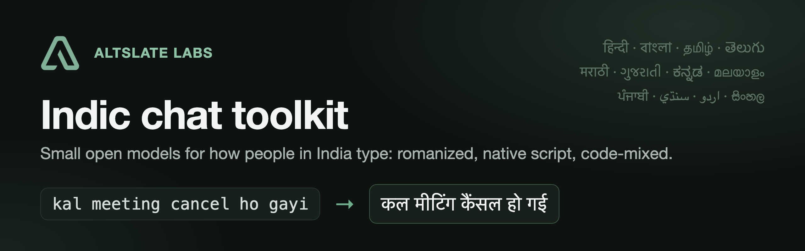

<p align="center"></p>

<p align="center">
  <a href="LICENSE"></a>
  <a href="https://huggingface.co/collections/altslate/indic-chat-toolkit-6b00d1ccbffba7be2baa5fdd"></a>
  
  
  
</p>

# Indic chat toolkit: training and evaluation code

Code behind nine small models for Indian-language text and a browser screenshot redactor: message-level and word-level language ID and transliteration for romanized and native-script chat in 12 South Asian languages (Hindi, Bengali, Tamil, Telugu, Marathi, Gujarati, Kannada, Malayalam, Punjabi, Urdu, Sindhi, Sinhala), text normalization for speech in 10 of them, both directions (TTS input and ASR output), punctuation restoration for ASR output, sentence embeddings for native, romanized and code-mixed text, a search reranker, and translation of Hinglish and other Indian-language chat into English.

| Model | What it does | Size | Hub | Demo |
|---|---|---|---|---|
| [**indic-chat-lid-small**](https://huggingface.co/altslate/indic-chat-lid-small) | Language ID, native script **and** romanized (26 labels) | 140M | [](https://huggingface.co/altslate/indic-chat-lid-small) | [](https://huggingface.co/spaces/altslate/indic-chat-lid) |
| [**indic-chat-wordlid-small**](https://huggingface.co/altslate/indic-chat-wordlid-small) | Word-level language ID for code-mixed chat (12 languages + English, incl. two Indian languages in one message) | 140M | [](https://huggingface.co/altslate/indic-chat-wordlid-small) | [](https://huggingface.co/spaces/altslate/indic-chat-lid) |
| [**indic-chat-xlit-small**](https://huggingface.co/altslate/indic-chat-xlit-small) | Romanized chat → native script, whole sentences | 300M | [](https://huggingface.co/altslate/indic-chat-xlit-small) | [](https://huggingface.co/spaces/altslate/indic-chat-xlit) |
| [**indic-tts-normalizer-small**](https://huggingface.co/altslate/indic-tts-normalizer-small) | Written → spoken form for TTS (₹ amounts, times, dates, phone numbers, units, cricket scores…), 10 languages | 300M | [](https://huggingface.co/altslate/indic-tts-normalizer-small) | [](https://huggingface.co/spaces/altslate/indic-tts-normalizer) |
| [**indic-punctuation-base**](https://huggingface.co/altslate/indic-punctuation-base) | Punctuation restoration (comma, sentence end, question) for ASR output, 12 languages + English | 307M | [](https://huggingface.co/altslate/indic-punctuation-base) | – |
| [**indic-itn-small**](https://huggingface.co/altslate/indic-itn-small) | Spoken → written for ASR output (numbers, ₹, times, dates → digits), 10 languages | 300M | [](https://huggingface.co/altslate/indic-itn-small) | [](https://huggingface.co/spaces/altslate/indic-tts-normalizer) |
| [**indic-embed-small**](https://huggingface.co/altslate/indic-embed-small) | Sentence embeddings for native-script, romanized and code-mixed Indic text + English (10 languages); search native text with romanized queries | 140M | [](https://huggingface.co/altslate/indic-embed-small) | – |
| [**indic-rerank-small**](https://huggingface.co/altslate/indic-rerank-small) | Reranker (cross-encoder) for Hindi, Bengali, Telugu and English search, including romanized queries | 140M | [](https://huggingface.co/altslate/indic-rerank-small) | – |
| [**indic-chat-mt-small**](https://huggingface.co/altslate/indic-chat-mt-small) | Translation of Hinglish and romanized or native-script chat in 10 Indian languages into English | 483M | [](https://huggingface.co/altslate/indic-chat-mt-small) | [](https://huggingface.co/spaces/altslate/indic-chat-mt) |

Results, data provenance and limitations are on the model cards. This repository is the code **as it was run** to build and test them: research scripts, not a library. It is published so the numbers on the cards can be checked and reproduced.

## Demos

All three demos run the int8 ONNX models in your browser with [transformers.js](https://github.com/huggingface/transformers.js); your text never leaves your device.

<table>
<tr>
<td width="50%"><a href="https://huggingface.co/spaces/altslate/indic-chat-xlit"></a><br><sub><b>Transliteration</b>: romanized Hindi to Devanagari, about 2 s in the browser.</sub></td>
<td width="50%"><a href="https://huggingface.co/spaces/altslate/indic-chat-lid"></a><br><sub><b>Language ID</b>: "tuition-e jabe ki bhabcho?" → romanized Bengali, 97%.</sub></td>
</tr>
</table>

## Layout

```
src/wordlid/ word-level language ID: labelled mixed-message synthesis, COMI-LINGUA test, English-word convention, training, ONNX checks
src/lid/     language ID: data synthesis, training (mmBERT-small), test sets, comparisons with GlotLID and IndicLID, ONNX export
src/xlit/    transliteration: data building, training (ByT5-small), prediction, CER metric, IndicXlit / UnimeType baselines, ONNX checks
src/tn/      TTS normalization: carrier sentences, slot filling with exact spoken forms, number-word fixes, tests, LLM judge, baselines
src/vision/  screenshot PII redaction: chat-screenshot renderer with exact PII boxes, PP-OCRv5 ONNX runner (numpy + Pillow), scorer
src/punct/   punctuation restoration: data from punctuated text, 1-800-BAD-CODE baseline, F1 scorer, ONNX checks
src/itn/     inverse text normalization: the TN data reversed with canonical written forms, real-sentence tests, digit-match scorer, baselines
src/rerank/  reranker: MIRACL candidate lists with indic-embed-small negatives, teacher scores, listwise distillation, MIRACLReranking eval, ONNX checks
src/embed/   sentence embeddings: romanizer (dictionaries + rules), distillation data, teacher encoding, training, evaluation, sentence-transformers + ONNX packaging
src/mt/      translation to English: PHINC split, data building (Hinglish, romanized NLLB, Ornith chat), teacher translation, M2M100 training, chrF++ eval, LLM judge, ONNX checks
jobs/<id>/   the shell script for each GPU job, in the order they were run (see below)
spaces/      the browser demos (static HTML + transformers.js; the models run in the browser)
```

### Which jobs produced the released models

**indic-chat-lid-small (released version = `lid-v4`)**

1. `lid-gap`: Dakshina test-split test set (test A) and the first GlotLID comparison.
2. `lid-testb`: chat test set (test B), written by a separate "test teacher" model (Qwen3.8-27B) that wrote no training text.
3. `lid-chat`, `lid-chat4`: romanized chat training pairs written by the training teacher (Ornith-1.5-35B-A3B), including out-of-scope Indic languages as `other`.
4. `lid-indiclid`: the IndicLID baseline (FTN/FTR + BERT stage).
5. `lid-v4`: training data synthesis (`src/lid/synth_lid.py`), training (`src/lid/train_lid.py`) and the comparison tables.
6. `onnx-lid`: ONNX export and int8 quantization.

**indic-chat-wordlid-small (released version = `wordlid-v3`)**

1. `wordlid-gap` (no script): COMI-LINGUA LID test (`src/wordlid/comi_test.py`, gold = majority of 3 annotators) and the PhysicsWallahAI/muril-hinglish-lid baseline (`baseline_muril.py`).
2. `wordlid-v1`: synthetic labelled messages (`synth_wordlid.py`) and the test-mix set from Dakshina's test split; `wordlid-v2`: + COMI-LINGUA train split, English Wikipedia; `wordlid-v3`: + English-word convention (`envocab.py`, applied to the test too via `relabel_test.py`) and real romanized chat segments.
3. `onnx-wordlid`: fp32 + per-channel int8 export (`src/export_onnx.py`, `src/requant_onnx.py`) and word accuracy through onnxruntime (`onnx_check.py`).

**indic-chat-xlit-small (v0 → v1 → v2; the Hub has tags `v0`, `v1`; `main` is v2)**

1. `xlit-gap`: test A (Dakshina test split) and test B (chat), plus copy baselines.
2. `xlit-indicxlit`: the AI4Bharat IndicXlit baseline (runs in a python:3.10 container with fairseq 0.12.2).
3. `xlit-v0`, `xlit-v1`, `xlit-v2`: data (`src/xlit/build_data*.py`), training (`src/xlit/train_xlit.py`) and evaluation; each version is warm-started from the previous one.
4. `onnx-xlit`: ONNX export, int8 quantization and greedy-decoding checks against PyTorch.

**indic-tts-normalizer-small (released version = `tn-v4b`; each version warm-starts from the previous one, the first from xlit v2)**

1. `tn-gap`: test A (Dakshina *validation* Wikipedia sentences with digits) and test B (messages written by the test teacher, Qwen3.8-27B); `run2.sh` runs the baselines (rules, indic-tts-preprocess, prompted Qwen3-4B) and the judge (`src/tn/judge.py`).
2. `tn-lex`: carrier sentences with one typed slot, written by the training teacher (Ornith-1.5-35B-A3B; `src/tn/gen_carriers.py`). The LLM-written lexicon from `make_lexicon.py` was rejected; `src/tn/lex_hand.py` is the hand-written replacement.
3. `tn-v1` … `tn-v4b`: data (`src/tn/fill_data.py`), training (`src/xlit/train_xlit.py`), held-out programmatic tests (`score_prog.py`), the hand-written sanity set and the judge. The header of each `run.sh` says what changed and why.
4. `onnx-tn`: ONNX export, int8 quantization and greedy-decoding checks (KV cache, as in transformers.js) against PyTorch.

**Screenshot PII redactor (Space `altslate/indic-screenshot-redactor`)**

`vision-probe`: renders held-out PII test messages as chat screenshots with exact pixel boxes (`src/vision/render_shots.py`, Noto fonts), reads them with PaddlePaddle's PP-OCRv5 ONNX models (`ppocr.py`, `ocr_shots.py`: detector + Latin and Devanagari recognizers, best confidence per line) and scores the redaction (`eval_shots.py`). The Space is a JavaScript port of the same pipeline.

**indic-punctuation-base (released version = `punct-v2`)**

1. Data and tests: `src/punct/synth_punct.py` (Dakshina train/test splits, Ornith chat with 10% held out, English Wikipedia; tn-gap test B as the messages test).
2. `punct-v1` (mmBERT-small) with `baseline.sh` (1-800-BAD-CODE xlm-roberta via `punctuators`, installed with `--no-deps` plus sentencepiece/omegaconf); `punct-v2`: mmBERT-base and more data. Scored with `score_punct.py`.
3. `onnx-punct`: fp32 + per-channel int8 (`src/export_onnx.py`, `src/requant_onnx.py`); the fp16 file was exported directly from PyTorch in half precision on the GPU; F1 through onnxruntime with `predict_onnx.py`.

**indic-itn-small (released version = `itn-v2`, warm-started from itn-v1, which started from tn-v4b)**

1. Data: `src/tn/fill_data.py` writes an `itn` field (canonical written form) next to each TN pair; `src/itn/make_itn.py` turns a TN data folder into ITN pairs (punctuation stripped from half the inputs). Baselines: `src/itn/baseline_copy.py` and `src/itn/baseline_indicpunct.py`; indic-punct needs pynini, which has no aarch64 wheel for Python 3.12, so it ran in a `condaforge/miniforge3` container (`conda create -n itn -c conda-forge python=3.10 pynini`, then `pip install --no-deps indic-punct` plus `inflect tqdm joblib regex`).
2. `itn-v1`: 1 epoch on the reversed TN data. `itn-v2`: + 15k sentences with internal-zero numbers (`src/itn/zeros.py`; v1 turned 1024 into 124) mixed with 45k v1 rows; `queue.sh` waits for a free GPU.
3. `itn-eval`: real-sentence tests (`src/itn/make_tests_real.py`): test A = Dakshina validation sentences spoken by rules; test B = LLM-written messages whose spoken form the judge accepts. Scored by digit match (`src/itn/score_itn.py`).

**indic-embed-small (released version = `embed-v5b`; Hub tag `v1` = embed-v3; each round fine-tunes the previous one)**

1. `embed-probe`, `embed-eval`: baselines (l3cube indic sbert, bge-m3, LaBSE, multilingual-e5-small, MiniLM) on the evaluation suite (`src/embed/evaluate.py`; dev splits for choices).
2. Data for round 1: `src/embed/build_data.py` (Dakshina native train sentences, romanized with `romanizer.py`/`rule_roman.py`; English Wikipedia; english-to-hinglish), teacher vectors with `src/embed/teacher.py` (bge-m3).
3. `embed-v1` (round 1), `embed-v2` (+ native sentences, `build_native_extra.py`), `nllb-fetch` + `embed-v3` (English–Indic pairs from allenai/nllb, `filter_nllb.py`, `build_xling.py`). `diag_sts.py` is the diagnostic that showed the Indic side was losing graded similarity.
4. `embed-test`: the one test-split run. Packaging: `package_st.py` (also makes the files load in transformers 4.x), `check_st.py`, `export_onnx.py` (fp32 + fp16).
5. v2: `embed-v5` (+ 500k English SNLI sentences, `build_nli_text.py`; replays 1.0M embed-v3 rows via `build_mix.py`), leakage check `neardup_sts.py` (STS Benchmark sentences with a near-duplicate in the training text), then `embed-v5b` (same, with near-duplicates of every eval sentence removed) and `embed-v5b-test` (the one test-split run).

**indic-rerank-small (released version = `rerank-v2`; Hub tag `v1` = rerank-v1)**

1. `rerank-base`: MIRACLReranking dev baselines (`src/rerank/eval_rerank.py`; nDCG@10, native and romanized queries).
2. `rerank-data`: MIRACL train queries (hi, bn, te) with judged passages + top-30 indic-embed-small negatives, scored by bge-reranker-v2-m3 (`build_lists.py`).
3. `rerank-v1`: training (`train_rerank.py`: native / romanized / half-romanized queries, teacher scores of the native query) and the dev evaluation. Packaging: `package_ce.py` (transformers 4.x compatibility), `check_ce.py`, `export_onnx.py` (fp32 + fp16; int8 rejected).
4. `rerank-v2`: English lists from Natural Questions pairs (`build_lists_en.py`) and 3,000 more steps from rerank-v1 on Indic + English lists.

**indic-chat-mt-small (released version = `mt-v4`)**

1. `mt-base`: PHINC split (`src/mt/split_phinc.py`, test 3,000 / dev 1,000 / train) and baselines (copy, opus-mt, NLLB-600M). `mt-eval1`: FLORES dev native + romanized (`make_flores_mt.py`); `mt-eval3`: COMI-LINGUA dev (`make_comi_mt.py`, from MT_train only).
2. `mt-probe` / `mt-v1` / `mt-v2`: Marian (77M) rounds. Data: `build_data.py` (english-to-hinglish with every PHINC dev/test match removed + PHINC train), `build_mix_mt.py` (+ allenai/nllb pairs, native and romanized), `mt-orn1` + `build_mix_mt2.py` (Ornith English for the Hinglish sources, filtered). `mt-eval2`/`mt-eval4`: judge runs (`judge_mt.py`).
3. `mt-probe2`: M2M100-418M probe, which beat the Marian student; `mt-v3`: M2M100 on the round-2 data with a per-row source-language token (`train_mt.py --src_lang auto`).
4. `mt-v3b`: Telugu → Kannada script map (M2M100 has no Telugu letters; `te2kn_probe.py` measured it), native Telugu upweighted.
5. `mt-chat-test`: chat test in 10 languages (the transliteration project's test B; judged, no references). `mt-v4`: 21k Ornith-written chat messages translated by Ornith (`build_chat_mt.py`, 40/language held out as chat dev), 5k more steps.
6. `mt-test` (mt-v3b, baselines) and `mt-test4` (mt-v4): the one test-split runs. `onnx-mt4`: fp32 / fp16 / int8 ONNX (`greedy_ref_m2m.py` writes the PyTorch reference for the transformers.js check).

Also kept, not released: `embed-v4probe` (contrastive-weight ablation, no effect) and `embed-base` (mmBERT-base student, only +0.8 STS; `wait_resume.sh` resumes chunks only when no other users' containers hold the GPU).

Some job scripts read outputs of earlier jobs (for example cached GlotLID predictions). Test sets were never used for training or for choosing settings; exact overlap between training data and test sets is checked in `jobs/lid-v4/run.sh` and `src/xlit/build_data.py`.

## Environment

Everything ran on one NVIDIA DGX Spark (GB10, aarch64, 121 GB unified memory). Scripts assume:

- the code lives at `~/agent/rnd/` with one Python venv per task under `envs/` (PyTorch + transformers for training; fastText for GlotLID / IndicLID),
- models in `~/Downloads/model/<name>/` and datasets in `~/Downloads/data/<name>/`,
- teacher models served with vLLM (`vllm/vllm-openai`) or llama.cpp (`ghcr.io/ggml-org/llama.cpp:server-cuda13`) in Docker on localhost.

Adjust the paths to your machine. Teacher-written data is not included here; the scripts that write it (`src/lid/gen_chat_train.py`, `src/lid/make_chat_test.py`, `src/xlit/make_tests.py`) contain the full prompts.

## Data and licenses

- [Dakshina](https://github.com/google-research-datasets/dakshina) (Google, CC BY-SA 4.0): lexicons, Wikipedia sentences, human romanizations (dev split for training, test split only for testing).
- [Aksharantar](https://huggingface.co/datasets/ai4bharat/Aksharantar) (AI4Bharat; CC0 mined pairs, CC-BY manual pairs): word pairs for xlit v2.
- [Hinglish-Everyday-Conversations-1M](https://huggingface.co/datasets/Abhishekcr448/Hinglish-Everyday-Conversations-1M) (MIT), [english-to-hinglish](https://huggingface.co/datasets/findnitai/english-to-hinglish) (Apache-2.0), [wikimedia/wikipedia](https://huggingface.co/datasets/wikimedia/wikipedia) (CC BY-SA 4.0): LID training text.
- [COMI-LINGUA](https://huggingface.co/datasets/LingoIITGN/COMI-LINGUA) (LingoIITGN, CC BY 4.0): LID train split for word-level LID training, test split for testing.
- Teacher outputs from [Ornith-1.5-35B-A3B](https://huggingface.co/ornith-ai/Ornith-1.5-35B-A3B) (MIT).
- [MIRACL](https://huggingface.co/datasets/miracl/miracl) train topics/qrels and corpus (Apache-2.0; Wikipedia passages CC BY-SA) for the reranker; [mteb/MIRACLReranking](https://huggingface.co/datasets/mteb/MIRACLReranking) (CC BY-SA 4.0) only for testing. Reranker teacher: [BAAI/bge-reranker-v2-m3](https://huggingface.co/BAAI/bge-reranker-v2-m3) (Apache-2.0).
- [allenai/nllb](https://huggingface.co/datasets/allenai/nllb) (ODC-BY 1.0; CommonCrawl-derived, upstream terms apply): English–Indic sentence pairs for the embedder. Embedder teacher: [BAAI/bge-m3](https://huggingface.co/BAAI/bge-m3) (MIT); STS Benchmark ([mteb/stsbenchmark-sts](https://huggingface.co/datasets/mteb/stsbenchmark-sts)), IndicCrosslingualSTS and IndicGenBench FLORES only for testing.
- TTS normalizer and ITN number words: [indic-numtowords](https://github.com/AI4Bharat/indic-numtowords) (AI4Bharat, MIT), with corrections in `src/tn/lex_hand.py`; month and unit names from Unicode CLDR via [babel](https://babel.pocoo.org/) (Unicode license).

`src/xlit/indicxlit/custom_interactive.py` is from fairseq (Facebook, MIT; distributed with AI4Bharat IndicXlit) and keeps its original header.

## License

Apache-2.0 (see `LICENSE`), except third-party files noted above.

## Citation

Dakshina: Roark et al., *Processing South Asian Languages Written in the Latin Script: the Dakshina Dataset*, LREC 2020. IndicXlit and Aksharantar: Madhani et al., *Aksharantar: Open Indic-language Transliteration datasets and models for the Next Billion Users*, 2023.
